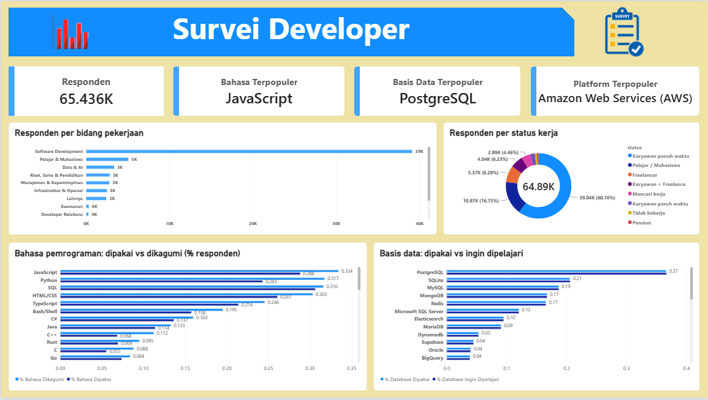

# Dashboard Survei Developer: Analisis Teknologi yang Dipakai dan Diminati


Proyek ini bertujuan untuk menganalisis tren penggunaan teknologi dan karakteristik pengembang berdasarkan data survei developer. Analisis berfokus pada bahasa pemrograman, teknologi basis data, platform yang digunakan, bidang pekerjaan, dan status pekerjaan responden. Hasil analisis disajikan dalam dashboard interaktif menggunakan Power BI untuk membantu memahami teknologi yang populer, perbedaan antara teknologi yang digunakan dan dikagumi, serta distribusi responden berdasarkan karakteristik pekerjaan mereka.

Proyek ini dibuat sebagai proyek capstone analisis data dan business intelligence memakai Power BI, DAX, dan pemodelan data berelasi.

## 1. Tujuan

- Mengetahui bahasa pemrograman, basis data, dan platform cloud yang paling banyak dipakai.
- Membandingkan teknologi yang **sedang dipakai** dengan yang **dikagumi / ingin dipelajari** untuk melihat arah minat developer.
- Melihat bagaimana pola tersebut berbeda menurut **status kerja** dan **bidang pekerjaan**.

## 2. Sumber Data

Enam file CSV, semuanya terhubung lewat kolom `id` (satu `id` = satu responden).

| File | Isi | Kolom utama | Jumlah baris |
|---|---|---|---|
| `Table_Employment.csv` | Profil pekerjaan responden | `id`, `status_pekerjaan`, `jenis_pekerjaan_pengembang`, `status`, `pekerjaan` | 65.436 |
| `Table_Language_Now.csv` | Bahasa yang dipakai | `id`, `bahasa_pemrograman_yang_digunakan` | 322.233 |
| `Table_NextLanguage.csv` | Bahasa yang dikagumi | `id`, `bahasa_pemrograman_yang_dikagumi` | 189.203 |
| `Table_Database_Now.csv` | Basis data yang dipakai | `id`, `basis_data_yang_digunakan` | 154.257 |
| `Table_NextBasisData.csv` | Basis data yang ingin dipelajari | `id`, `basis_data_yang_ingin_dipelajari` | 127.439 |
| `Table_Platform.csv` | Platform cloud yang dipakai | `id`, `platform_yang_digunakan` | 99.345 |

Catatan struktur data:
- `Table_Employment` berisi satu baris per responden (`id` unik), sehingga berperan sebagai **tabel dimensi** responden.
- Lima tabel lainnya berbentuk **long format**: satu responden bisa punya banyak baris, karena satu orang dapat memilih lebih dari satu bahasa, basis data, atau platform.
- Kolom `status` dan `pekerjaan` di `Table_Employment` adalah versi yang sudah dirapikan ke bahasa Indonesia dan dipakai untuk slicer. Sebanyak 5.991 responden bernilai "Belum diisi" pada bidang pekerjaan.

## 3. Model Data

```
                       Table_Employment (id unik)
                               | 1
     ┌───────────┬─────────────┼─────────────┬──────────────┐
     * Table_Language_Now      * Table_Database_Now          * Table_Platform
     * Table_NextLanguage      * Table_NextBasisData
```

- Relasi: `Table_Employment[id]` → tiap tabel lain pada `id`, **One to many**, arah filter **Single**.
- Akibatnya, slicer status dan pekerjaan otomatis menyaring semua visual.

Untuk membandingkan "dipakai" dengan "dikagumi" dalam satu grafik, dibuat dua **tabel dimensi bersama** dengan DAX (*Modeling → New table*):

```dax
Dim_Bahasa =
DISTINCT (
    UNION (
        SELECTCOLUMNS ( Table_Language_Now, "Bahasa", Table_Language_Now[bahasa_pemrograman_yang_digunakan] ),
        SELECTCOLUMNS ( Table_NextLanguage, "Bahasa", Table_NextLanguage[bahasa_pemrograman_yang_dikagumi] )
    )
)

Dim_Database =
DISTINCT (
    UNION (
        SELECTCOLUMNS ( Table_Database_Now, "Database", Table_Database_Now[basis_data_yang_digunakan] ),
        SELECTCOLUMNS ( Table_NextBasisData, "Database", Table_NextBasisData[basis_data_yang_ingin_dipelajari] )
    )
)
```

Relasi tambahan (One to many, Single):
- `Dim_Bahasa[Bahasa]` → `Table_Language_Now[bahasa_pemrograman_yang_digunakan]` dan `Table_NextLanguage[bahasa_pemrograman_yang_dikagumi]`
- `Dim_Database[Database]` → `Table_Database_Now[basis_data_yang_digunakan]` dan `Table_NextBasisData[basis_data_yang_ingin_dipelajari]`

## 4. Measure DAX

**Dasar**
```dax
Responden = DISTINCTCOUNT ( Table_Employment[id] )
```

**Persentase dipakai vs dikagumi**
```dax
% Bahasa Dipakai   = DIVIDE ( DISTINCTCOUNT ( Table_Language_Now[id] ),  [Responden] )
% Bahasa Dikagumi  = DIVIDE ( DISTINCTCOUNT ( Table_NextLanguage[id] ),  [Responden] )
% Database Dipakai = DIVIDE ( DISTINCTCOUNT ( Table_Database_Now[id] ),  [Responden] )
% Database Ingin Dipelajari = DIVIDE ( DISTINCTCOUNT ( Table_NextBasisData[id] ), [Responden] )
```

**Yang terpopuler (untuk visual Card)**
```dax
Bahasa Terpopuler =
CONCATENATEX (
    TOPN (
        1,
        VALUES ( Table_Language_Now[bahasa_pemrograman_yang_digunakan] ),
        CALCULATE ( DISTINCTCOUNT ( Table_Language_Now[id] ) ), DESC
    ),
    Table_Language_Now[bahasa_pemrograman_yang_digunakan], ", "
)
```
Measure `Basis Data Terpopuler` dan `Platform Terpopuler` memakai pola yang sama, dengan tabel dan kolom masing-masing.

Hal penting dalam rumus-rumus ini:
- Memakai `DISTINCTCOUNT` pada `id`, bukan menghitung baris, agar responden yang sama tidak terhitung dua kali.
- `CALCULATE` di dalam `TOPN` membuat hitungan dilakukan **per bahasa**. Tanpanya, semua bahasa memiliki angka yang sama.
- `CONCATENATEX` dipakai (bukan `MAXX`) agar kalau ada dua yang imbang, keduanya tampil.
- Visual KPI hanya menerima angka, sedangkan nama terpopuler berupa teks, sehingga memakai visual **Card**.

## 6. Temuan Awal

Dari dashboard (tanpa filter):
- **Bahasa terpopuler:** JavaScript
- **Basis data terpopuler:** PostgreSQL
- **Platform terpopuler:** Amazon Web Services (AWS)
- **Total responden:** 65.436, dengan sebagian besar bekerja di bidang *Software Development* (sekitar 39 ribu) dan berstatus karyawan penuh waktu (sekitar 39 ribu).

## 7. Insight dan Rekomendasi

| Tema | Insight | Rekomendasi |
| --- | --- | --- |
| Profil responden | Software Development mendominasi (±39K dari 65.436K) dan karyawan penuh waktu mencapai 60,16%. Keamanan dan Developer Relations sangat kecil. | Baca hasil sebagai cerminan developer profesional. Untuk segmen kecil, tambah sampel atau buat survei khusus. |
| Bahasa terpopuler | JavaScript paling banyak dipakai. Python dan SQL paling diminati untuk dipelajari. | Jadikan JavaScript, Python, dan SQL inti kurikulum dan kriteria perekrutan. |
| Retensi bahasa | Retensi 85,15% menunjukkan sebagian besar developer setia pada bahasa yang dipakai. | Prioritaskan bahasa berretensi tinggi untuk investasi jangka panjang dan pantau yang retensinya rendah. |
| Dikagumi vs dipakai | Beberapa bahasa (misalnya Python) punya minat belajar tinggi dibanding pemakaian. | Siapkan materi pelatihan lebih awal untuk bahasa dengan selisih besar. |
| Basis data | PostgreSQL unggul jauh (0,37) dibanding SQLite (0,21) dan MySQL (0,19). Supabase dan DynamoDB menunjukkan minat yang tumbuh. | Jadikan PostgreSQL basis data utama untuk pelatihan dan produk. Pantau Supabase dan DynamoDB. |
| Status pekerjaan | Python dominan di pelajar (0,50) dan Riset & Sains (0,46), tetapi lebih rendah di Software Development (0,36). TypeScript lebih tinggi di industri (0,41) daripada pelajar (0,23). | Perkenalkan TypeScript di kurikulum pelajar untuk menutup kesenjangan pendidikan dan industri. |
| Kualitas data | Total donut chart (64.89K) berbeda dengan jumlah responden (65.436K), dan kolom pertama tabel terpotong. | Periksa data kosong/duplikat dan lebarkan kolom tabel. |


